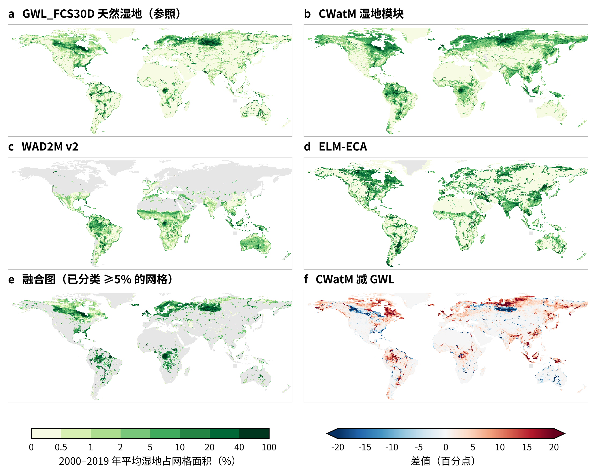
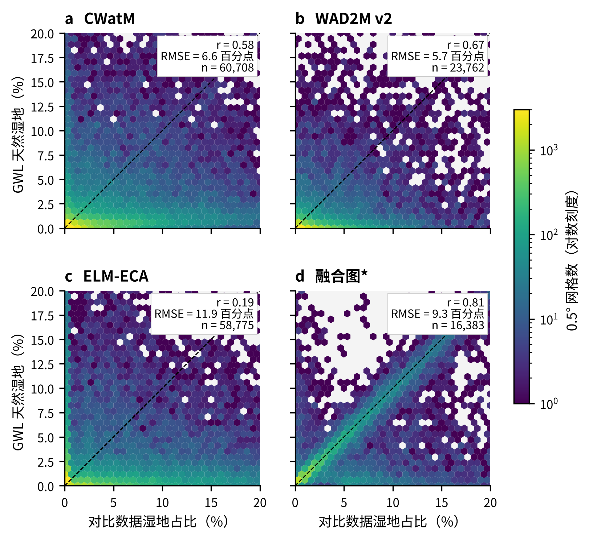
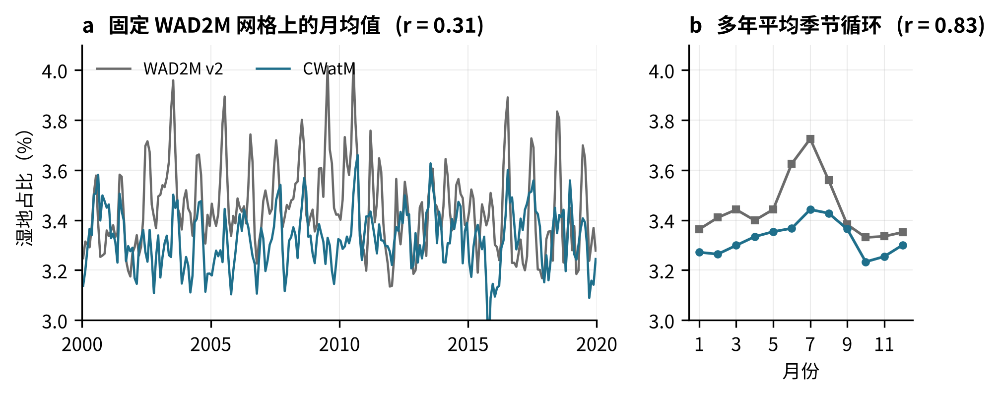

# Global historical experiment (0.5°, 2000–2019)

1999 zero-storage spin-up; five-parameter candidate 005 selected after an eight-candidate 2000 WAD2M screen and 2001–2005 check. Source: CWatM wetland commit `55cbb4ac06c06066557f4d8a2135712c6f15b41d`.

| Comparison | Result |
| --- | --- |
| WAD2M monthly union area, 2000–2019 | Area-weighted RMSE 0.074042; bias −0.000901; 10,097,816 paired grid-months. |
| WAD2M fixed-cell monthly correlation | Area-weighted per-cell mean `r = 0.073920` on reference-dynamic cells. |
| WAD2M candidate-area exceedance | 23.49% of paired grid-months; implied RMSE lower bound 0.02839 for this spatial prior. |
| ELM-ECA monthly cross-model comparison | Area-weighted RMSE 0.122963; bias −0.011654. |
| GWL_FCS30D 2000–2019 spatial mean | CWatM–GWL area-weighted spatial `r = 0.584`; RMSE 6.64 percentage points. GWL 2020 contributes to the spatial prior. |
| GWL_FCS30D annual local time series | Area-weighted per-cell mean `r = −0.007` on reference-dynamic cells. |

Modeled union area = `wetVegSaturatedFrac + wetSurfaceInundFrac - wetlandInundVegFrac`. The two component areas are separate model outputs; WAD2M does not observe them separately. Candidate 005 is exploratory, not a final independent physical calibration.

